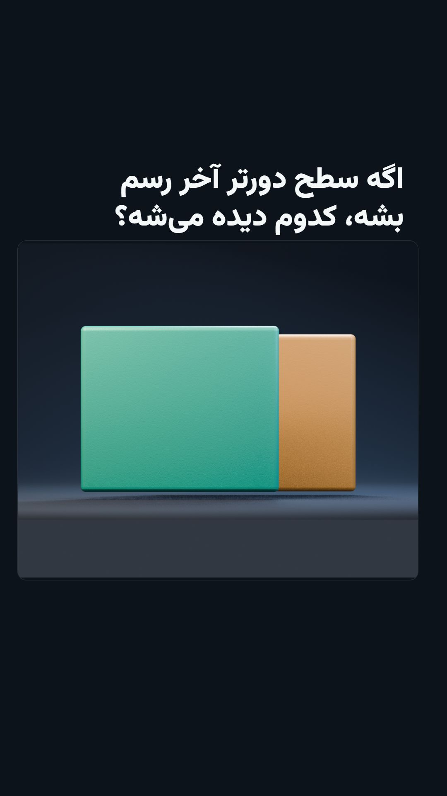
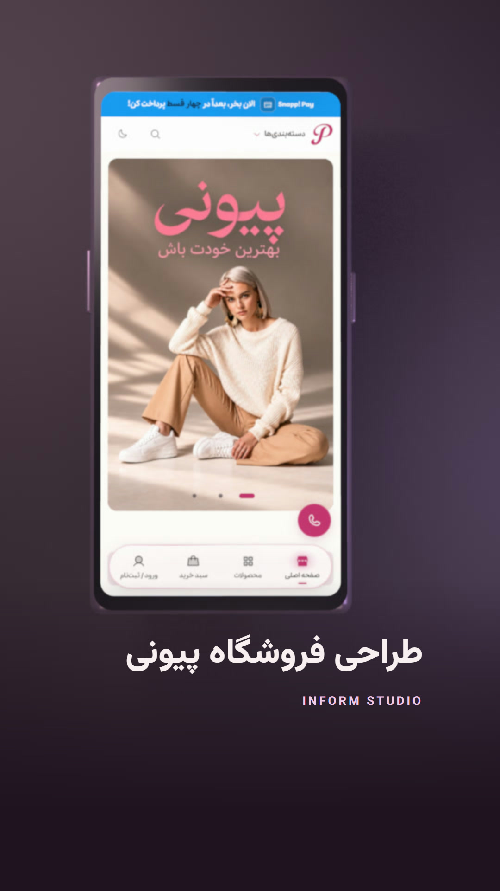
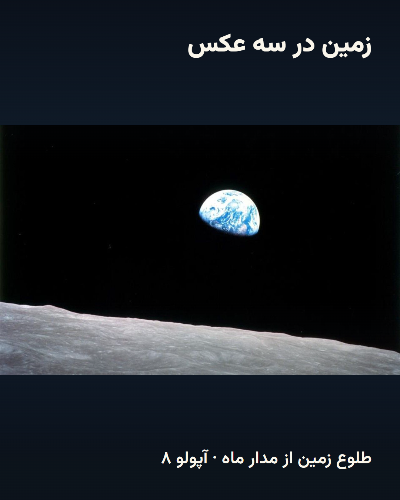
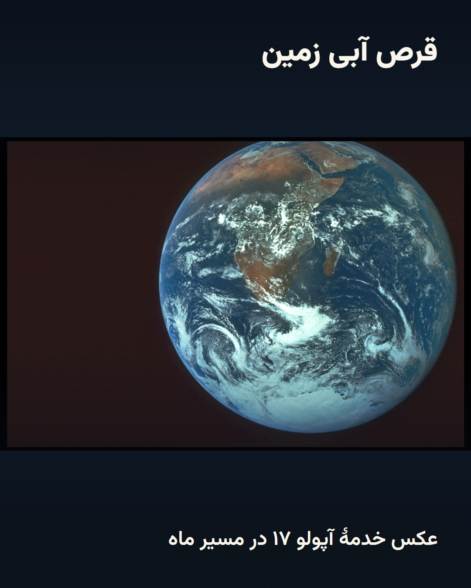
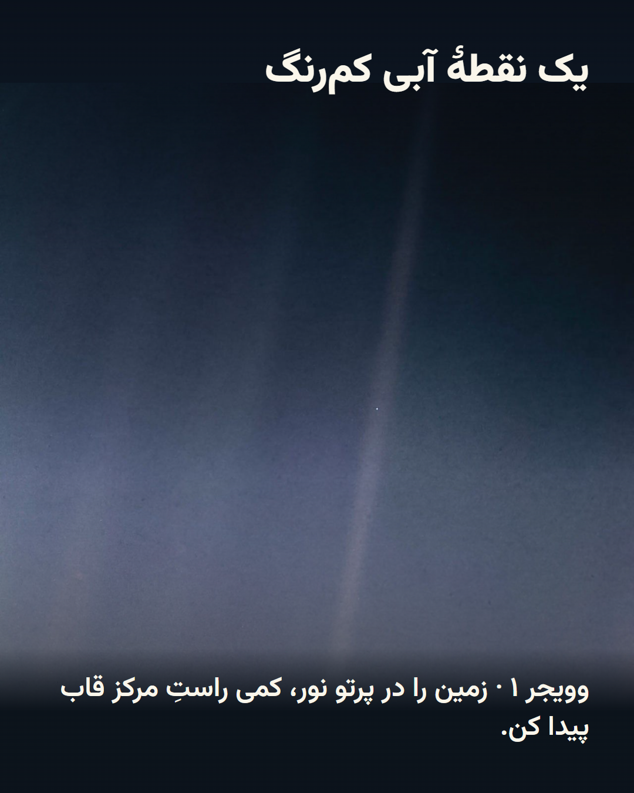

# AI Video Maker

گردش‌کار ایجنتیک برای تبدیل عکس، فوتیج، متن و سناریو به ریلز، پست، کاروسل و استوری. برای هر پروژه می‌توان استوری‌بورد، زیرنویس، صدا و تایم‌لاین را جداگانه ویرایش کرد. این مخزن در حال توسعه است و به‌روزرسانی‌های بیشتری برای قالب‌ها، آموزش سه‌بعدی و تجربهٔ ساخت محتوا در راه‌اند.

Agentic production workflow for creating short videos and social content from photos, clips, and text, with editable storyboards, captions, and frame-based timelines.

## نمونه‌خروجی‌ها

| آموزش سه‌بعدی Depth Test | معرفی فروشگاه پیونی |
| :---: | :---: |
|  |  |
| ریل ۲۸ ثانیه‌ای فارسی با صحنهٔ Blender، نریشن مصنوعی و آزمایش واقعی WebGL. [دانلود MP4][depth-video] · [پروژه](projects/depth-test/) | ریل ۲۸ ثانیه‌ای با کپچر واقعی فروشگاه، گوشی سه‌بعدی و تایپوگرافی فارسی. [دانلود MP4][peony-video] · [پروژه](projects/peony/) |

**زمین در سه عکس** · کاروسل فارسی از تصاویر آرشیوی ناسا و JPL-Caltech. [پروژه و منابع](projects/photo-carousel/) · [دانلود هر سه اسلاید][carousel-zip]

<p>
  
  
  
</p>

[همهٔ فایل‌های نمونه و یادداشت نسخهٔ آزمایشی][release]

## فناوری‌ها

| ابزار | نقش |
|---|---|
| **Codex، ایجنت‌ها و اسکیل‌ها** | بریف، پژوهش، استوری‌بورد، طراحی حرکت، صدا و بازبینی تولید. |
| **Remotion، React و TypeScript** | تدوین فریم‌محور، تایپوگرافی متحرک، زیرنویس فارسی و پیش‌نمایش در Studio. |
| **Blender و Python** | مدل‌سازی، نورپردازی، حرکت دوربین و ساخت نماهای سه‌بعدی قابل‌ویرایش. |
| **FFmpeg و FFprobe** | برش و تبدیل رسانه، ساخت خروجی و بررسی کدک، فریم‌ها و بلندی صدا. |
| **Piper و Python** | نریشن فارسی محلی و ساخت لایه‌های صدا و افکت برای پایلوت Depth Test. |
| **Playwright و WebGL** | اجرای مثال Depth Test در مرورگر و کپچر رابط برای مسیر نمونه‌کار وب. |

## در به‌روزرسانی‌های بعدی

- قالب‌های بیشتر برای فوتیج، محتوای محصول و ریل‌های آموزشی.
- نمونه‌های برنامه‌نویسی با اجرای واقعی کد و صحنه‌های سه‌بعدی تازه.
- ابزارهای بهتر برای زمان‌بندی نریشن فارسی، زیرنویس و بازبینی موبایل.
- رابط وب برای ورود عکس و متن، پیگیری رندر و دریافت ویدئو.

## شروع با اسکیل‌ها

از همین پوشه در Codex شروع کن و قالب و خروجی مدنظرت را بگو. عکس، کلیپ، متن، سناریو یا لینک سایت را بده و مشخص کن کدام ورودی باید در خروجی استفاده شود و کدام فقط مرجع سبک است.

- «از این سه عکس محصول یک ریل ۲۰ ثانیه‌ای با حس سینمایی بساز. عکس دوم مرجع رنگ است.»
- «این متن را برای تازه‌کارها به یک کاروسل فارسی پنج‌اسلایدی تبدیل کن. فعلاً فقط متن و استوری‌بورد.»
- «از این سناریو سه استوری بساز. کارت اول تصویری، کارت دوم متحرک و کارت سوم جای استیکر لینک داشته باشد.»

اسکیل [تولید محتوای اینستاگرام](.agents/skills/instagram-content-production/SKILL.md) گردش‌کار مشترک را تعریف می‌کند. برای کار چندبخشی، [فایل‌های پروژه](.agents/skills/instagram-content-production/references/production-files.md) ثبت می‌کنند هر شات یا اسلاید چه هدفی دارد، از کدام مرجع استفاده می‌کند و چه بخش‌هایی تأیید شده‌اند. با شناسهٔ همان بخش می‌توان اصلاح موضعی درخواست کرد و پیش‌نمایش‌های معتبر را دوباره استفاده کرد. [راهنمای قالب‌ها](.agents/skills/instagram-content-production/references/formats.md) پیش‌فرض‌های خروجی و بازبینی هر قالب را مشخص می‌کند.

## گردش‌کار ریلز و پست آموزشی یا علمی

برای ریلز آموزشی، پست تک‌تصویر یا کاروسل، در درخواستت موضوع، مخاطب، زبان و قالب را مشخص کن. اسکیل `instagram-educational-content` ایجنت پژوهش و نویسندهٔ آموزشی را به گردش‌کار اضافه می‌کند. ابتدا ادعاها با منبع و بخش پشتیبان ثبت می‌شوند، سپس متن هر شات یا اسلاید نوشته و بازبینی می‌شود. صحنه یا اسلاید تأییدشده در اصلاح‌های موضعی حفظ می‌شود.

مثال درخواست «برای مخاطب تازه‌کار، فقط استوری‌بورد یک کاروسل فارسی پنج‌اسلایدی دربارهٔ تفاوت جرم و وزن را با منابع آماده کن.»

## ساخت و رندر یک پروژهٔ عمومی

برای اجرای نمونه‌های آماده در ویندوز، Node.js 20 یا بالاتر، Chrome و FFmpeg همراه FFprobe را نصب کن. در ریشهٔ مخزن یک بار `npm ci` اجرا کن. نماهای سه‌بعدی و صداهای پایلوت همراه پروژه هستند و برای بازسازی آن‌ها به Blender و Python نیاز داری.

یک پوشه در `projects/<slug>/` و پوشهٔ رسانه در `public/<slug>/` بساز. در بریف مقدار `format` را از `reel`، `image`، `carousel` و `story` انتخاب کن. ترتیب آیتم‌های ثابت از استوری‌بورد و ترتیب و زمان آیتم‌های متحرک از تایم‌لاین می‌آید.

```powershell
$env:REEL_PROJECT = 'depth-test'
npm run preview
npm run studio -- --no-open
npm run render
npm run verify
```

پیش‌نمایش در `.cache/<slug>/preview/` و خروجی در `out/<slug>/` است. در Studio ترکیب `ContentProduction` را انتخاب کن. ریلز به MP4 و کاور JPG می‌رسد. پست، کاروسل و استوری ثابت PNG شماره‌دار می‌گیرند. استوریِ دارای تایم‌لاین یک MP4 پیوسته می‌گیرد. اگر `caption.txt` کنار بریف باشد همراه خروجی کپی می‌شود. پیش‌نمایش و کنترل محتوا را قبل از انتشار دستی انجام بده.

برای تغییر کاور یک ریل، `coverFrame` را در بریف تغییر بده و `npm run cover` را اجرا کن. این فرمان فقط کاور را دوباره رندر می‌کند.

| فایل | ورودی رندر |
|---|---|
| `brief.json` | `title`، `format`، `language`، `style` اختیاری با `background`، `foreground`، `accent` و `titleSize`. برای پست ساده می‌توان `items` را اینجا گذاشت. |
| `assets.json` | نگاشت `files` از شناسه به `path` و `kind`. مسیر نسبت به پوشهٔ عمومی همان پروژه است. نوع دارایی `image`، `video` یا `audio` است. منبع و مجوز را کنار آن ثبت کن. |
| `storyboard.json` | `items` به ترتیب با `id`، `kind` از `image`، `video` یا `text` و `assetIds`. رندر از اولین منبع تصویری هر آیتم استفاده می‌کند. `title`، `onScreenText`، `layout: "panel"` و `fit: "contain"` اختیاری‌اند. منبع صوتی فوتیج پیش‌فرض بی‌صداست. `sourceVolume` و `trimBefore` برای کنترل حجم و برش ورودی‌اند. |
| `timeline.json` | برای خروجی متحرک، `fps`، `duration` بر حسب فریم و `shots` پیوسته با `id`، `from` و `to`. `to` خارج از بازه است. صدای سراسری اختیاری `audio: {"assetId":"mix"}` است. در آیتم می‌توان `captionCues` و `overlays` با بازهٔ محلی و `titleMotion` با `enterFrames` و `exitFrames` تعریف کرد. |

سه پروژهٔ نمونه در `projects` قرار دارند. `footage-demo` تدوین فوتیج، `photo-carousel` کاروسل سه‌عکسی و `depth-test` آموزش فارسی با صحنهٔ سه‌بعدی است. برای بازتولید دادهٔ ریل آموزشی به ترتیب `node projects/depth-test/example.mjs --write` و `node projects/depth-test/build-storyboard.mjs` را اجرا کن. صحنهٔ Blender و دستور بازسازی صدا در همان پوشه‌اند.

راهنمای [کارگردانی و تدوین](.agents/skills/instagram-content-production/references/direction-and-editing.md) ظاهر، انیماتیک، بازبینی و تمرین هفتگی پنج مرجع را پوشش می‌دهد.

## نمونهٔ آزمایشی پیونی

برای بازکردن نمونهٔ آزمایشی یا استفاده از فرمان‌های اختصاصی آن، `REEL_PROJECT` را روی `peony` بگذار. مسیر عمومی برای بریف‌هایی که `format` دارند استفاده می‌شود.

پروژهٔ محلی تولید ریلز برای Inform Studio. نسخهٔ پیونی ۲۸ ثانیه، ۳۰ فریم‌برثانیه و عمودی است. رندر از عکس‌ها و کپچرهای واقعی فروشگاه، صحنهٔ قابل‌ویرایش Blender و موسیقی اورجینال پروژه استفاده می‌کند.

## اجرای پروژهٔ نمونه‌کار پیونی در ویندوز

از پوشهٔ پروژه با Node.js، Python، Git، Chrome و Blender نصب‌شده اجرا کنید.

```powershell
$env:REEL_PROJECT = 'peony'
pwsh -File scripts/setup.ps1
npm run doctor
npm run capture
npm run smoke
npm run preview
npm run studio
npm run render:reel
```

`setup.ps1` ابزارها و اسکیل‌های محلی را نصب می‌کند و مسیر همین پوشه را در کانفیگ MCP ثبت می‌کند. `doctor` یک فراخوانی واقعی برای Blender headless و FFmpeg MCP انجام می‌دهد. برای بارگذاری کانفیگ پروژه، یک جلسهٔ تازهٔ Codex را در همین پوشه باز کنید و در صورت نمایش، تأیید اعتماد به پروژه را در رابط Codex انجام دهید. برای مسیرهای نصب متفاوت می‌توان از `BLENDER_BIN`، `REEL_CHROME` و `REEL_FFMPEG_BIN` استفاده کرد.

`capture` در اجرای مجدد منابع قبلی را استفاده می‌کند. برای تازه‌سازی از `npm run capture -- --force` و برای گرفتن دوبارهٔ برش کارت‌ها از `npm run capture -- --cards-only` استفاده کنید. ضبط مرور، ورود به صفحهٔ محصول و تغییر گالری در `public/peony/interaction-source.mp4` است. `smoke` سه فریم از شات Blender را از Remotion عبور می‌دهد. انیماتیک در `.cache/peony/animatic.mp4` و فایل‌های تحویل در `out/peony` قرار می‌گیرند. فایل `phone.blend` با عکس صفحهٔ اصلی در خود فایل ذخیره می‌شود. نسخهٔ نهایی پس از کنترل مشخصات، دیکد کامل و کنترل صدا جابه‌جا می‌شود.

## ساخت نمونه‌کار بعدی

1. پوشهٔ `projects/peony` را با نام پروژهٔ تازه کپی کنید و فایل کپشن را بازنویسی کنید. `slug`، آدرس‌ها، محصولات، متن‌های روی تصویر و مختصات نسبی نشانه‌های لمس را در `brief.json` به‌روز کنید. در PowerShell مقدار `$env:REEL_PROJECT` را برابر نام پوشه بگذارید.
2. با `capture` عکس‌ها و حالت‌های رابط را ثبت کنید. `assets.json` مسیر، URL منبع، عرض و ارتفاع هر کپچر را ثبت می‌کند. اگر ساختار فروشگاه تغییر کرده، سلکتورهای Playwright را در `scripts/capture.mjs` برای سایت تازه تنظیم کنید.
3. بازه‌های فریمی پیوسته و نشانه‌های صدا را در `timeline.json` تنظیم کنید. چینش این قالب شش شات دارد و جزئیات حرکت شات‌ها در `src/reel.tsx` قابل‌ویرایش است. صحنهٔ گوشی در `scripts/phone.py` و آهنگ و افکت‌ها در `scripts/soundtrack.mjs` هستند.
4. ابتدا انیماتیک را در ابعاد موبایل بررسی کنید، بعد رندر نهایی بگیرید. گزارش فنی در `.cache/<project>/render-verification.json` است. آپلود نهایی دستی است.

## منابع ابزار و اسکیل

| ابزار | نسخه یا commit |
|---|---|
| Remotion | `4.0.542` |
| Remotion best practices | `1fc074b74b95cfecf7b1e419132f2cfe23dafebe` |
| Video Shotcraft fork | `b1534bbfb892c1047f29f3fe63677b961844d37e` |
| Blender MCP | `428f60cdb819c55c69d67eef681f0318e464e0e9` |
| FFmpeg Skill | `3.4.3` |
| فونت Vazirmatn | نسخهٔ وب Google Fonts، مجوز OFL در `public/fonts` |

برای ریتم ورود کارت و نور روی محصول از دستور حرکت Spotlight Hero و Deck Deal در Shotcraft استفاده شده است. پخش دمو در محیط بررسی به خطای پخش YouTube رسید. موسیقی و افکت‌ها از مولد محلی پروژه ساخته شده‌اند.

[release]: https://github.com/pouyarouzbeh/ai-video-maker/releases/tag/v0.1.0-preview
[depth-video]: https://github.com/pouyarouzbeh/ai-video-maker/releases/download/v0.1.0-preview/depth-test-reel.mp4
[peony-video]: https://github.com/pouyarouzbeh/ai-video-maker/releases/download/v0.1.0-preview/peony-reel.mp4
[carousel-zip]: https://github.com/pouyarouzbeh/ai-video-maker/releases/download/v0.1.0-preview/earth-carousel.zip
